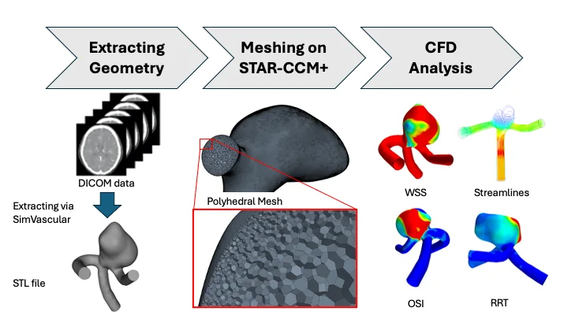
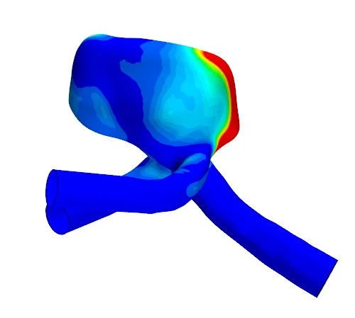
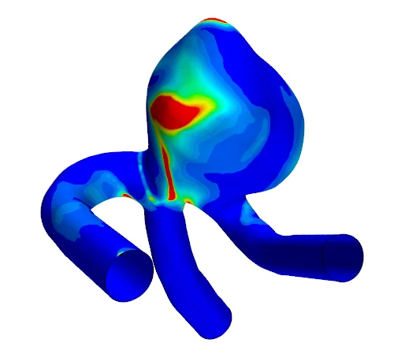
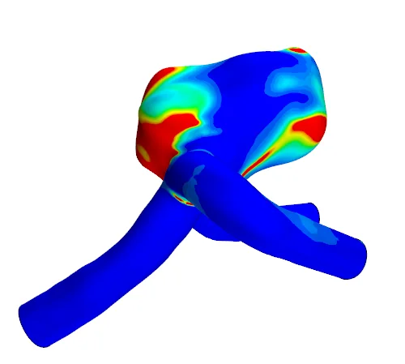
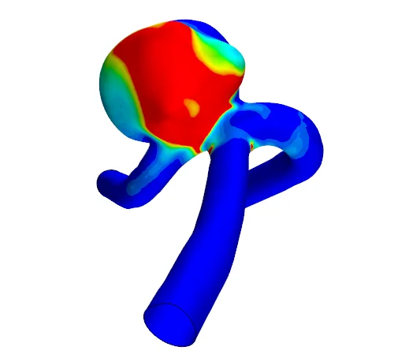
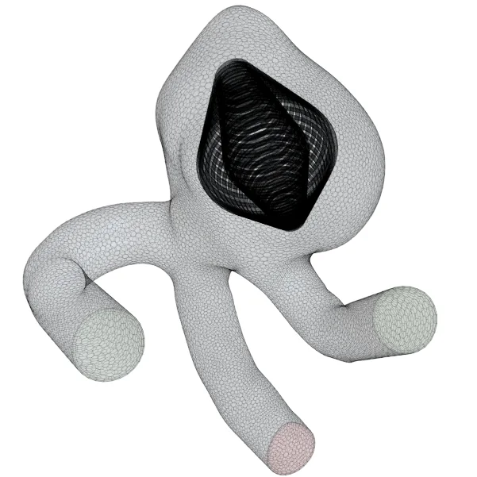
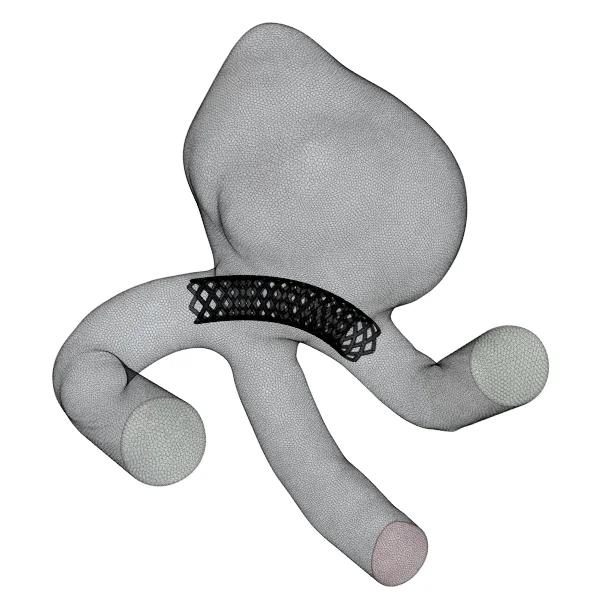

## Overview

My undergraduate dissertation, *Computational Fluid Dynamics for Intracranial Aneurysms in Clinical Settings*, was supervised by [Dr Amir Keshmiri](https://research.manchester.ac.uk/en/persons/a.keshmiri). It asked how patient-specific simulation could support the choice between treatments for a brain aneurysm. The methodology is under review at *Scientific Reports*.

## Pipeline

<figure class="figs">
  
  <figcaption>From patient imaging to haemodynamic risk output.</figcaption>
</figure>

1. **Geometry.** Patient-specific aneurysm geometries were segmented from 3D rotational angiography into anatomically accurate surface meshes.
2. **Meshing.** Polyhedral meshes were built in STAR-CCM+ with prism layers at the vessel wall to resolve near-wall shear.
3. **Simulation.** Pulsatile Navier–Stokes simulations ran across the cardiac cycle with patient-derived boundary conditions, for untreated, coiled and stented cases.
4. **Analysis.** Post-processing extracted wall shear stress (WSS), oscillatory shear index (OSI) and time-averaged WSS, the established markers of rupture risk.

I automated the meshing and set-up with JavaScript macros and Python, which cut pre-processing time by 40%.

<figure class="figs figs-4">
  
  
  
  
  <figcaption>Oscillatory shear index for Patient 2, untreated, from four views.</figcaption>
</figure>

## Treatment comparison

<figure class="figs figs-2 figs-contain">
  
  
  <figcaption>The two treatments modelled: endovascular coiling (left) and a flow-diverting stent (right).</figcaption>
</figure>

- Coiling reduced flow velocity, but in some cases left regions of residual circulation.
- Flow-diverting stents gave a larger drop in inflow jet momentum, lowering WSS and OSI across the aneurysm dome.
- High OSI and steep WSS gradients lined up with rupture-prone regions, in agreement with the clinical literature.

## Machine learning

The simulation outputs became features for a Scikit-learn rupture-risk classifier, validated with k-fold cross-validation and ROC analysis against radiologist-confirmed ground truth.

## Outcome

- 91% for the dissertation and 100% for the poster.
- IMechE Best Project Award, top 3 of 300.
- A proof of concept for patient-specific CFD as a decision-support tool in endovascular treatment planning, and the starting point for my [MSc work on neural surrogates](/projects/pinns/).

  <a class="btn btn-line" href="/assets/pdf/Dineth_Ilapperuma_11121002_Aneurysms.pdf" target="_blank" rel="noopener">Dissertation (PDF, 23 MB)</a>
  <a class="btn btn-line" href="/assets/pdf/TF38_Ilapperuma.pdf" target="_blank" rel="noopener">Poster (PDF)</a>

