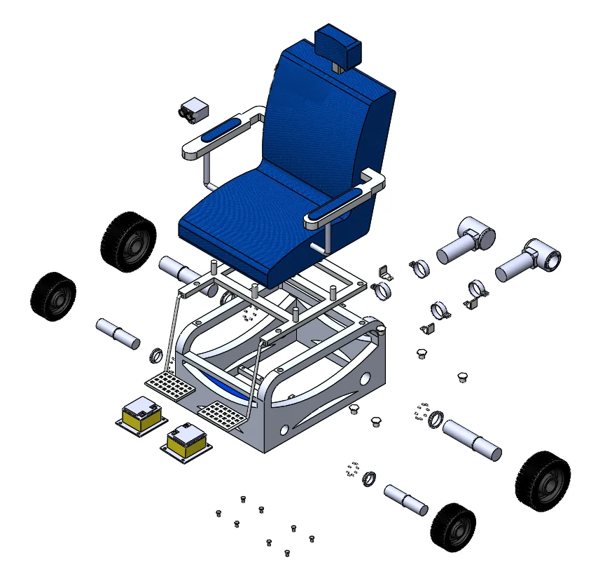
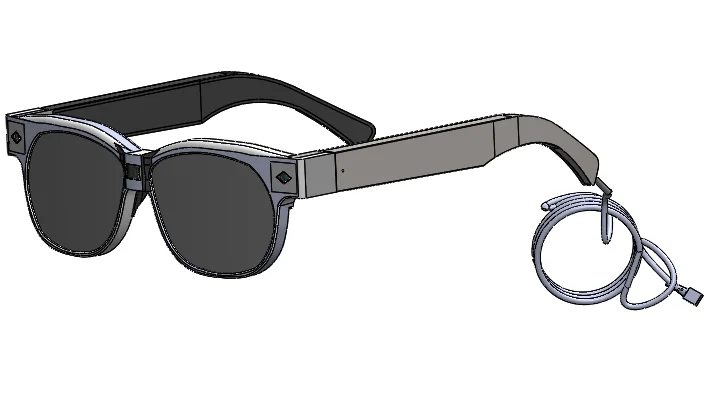
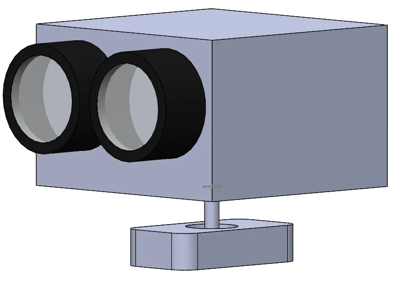
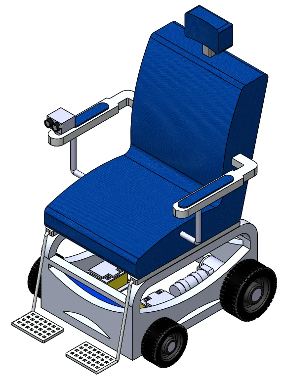
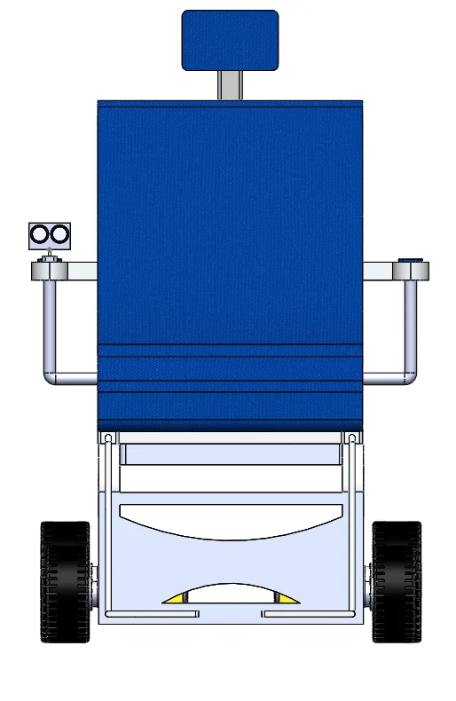
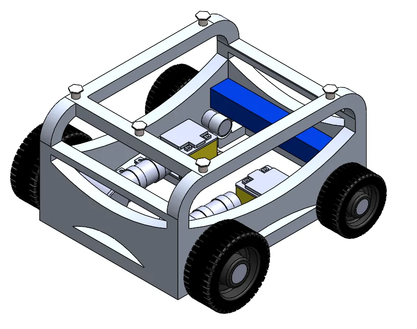

## Overview

People with high-level spinal cord injury, ALS or quadriplegia often keep voluntary eye movement but cannot use a joystick or sip-and-puff control. This device lets them drive a powered wheelchair hands-free.

An infrared eye tracker captures gaze direction at 60 Hz. A depth camera maps that gaze onto real floor coordinates. A control algorithm turns the result into proportional motor commands, all inside a 200 ms latency budget.

As one of a seven-person team at Imperial, I contributed to the design and to the full technical documentation required by EU MDR 2017/745 for a Class IIa active device.

<figure class="figs figs-contain">
  
  <figcaption>Exploded assembly: chassis, drive motors, seating, sensor frame, depth camera and eye-tracking module.</figcaption>
</figure>

## How it works

1. **Eye-tracking glasses.** Infrared, worn by the user, sampling gaze at 60 Hz with ±1° angular accuracy.
2. **RGB-D depth camera.** Mounted on the chair with a 0.5–4.0 m range. Gaze and depth are fused into a 3D gaze point, and a floor-detection step discards gaze that lands on walls or objects. This avoids the "Midas touch" problem of commands triggered by simply looking around.
3. **Control algorithm.** Two modes: a continuous control field mapping gaze position to velocity, and a natural decoder that uses a probabilistic model of gaze behaviour to output discrete motion states. The natural decoder reaches 15.3 bits per second.

<figure class="figs figs-2 figs-contain">
  
  
  <figcaption>Eye-tracking glasses (left) and the chair-mounted depth camera (right).</figcaption>
</figure>

## Design

The sensor suite fits a standard powered wheelchair platform. The mounts hold the eye tracker and depth camera to within 0.1° of each other, which calibration depends on, and the enclosures are rated to 1.0 g vibration from 5 to 500 Hz. The tracker, depth sensor and controller can each be serviced independently, which matters for a regulated device with documented maintenance procedures.

<figure class="figs figs-3 figs-contain">
  
  
  
  <figcaption>Assembled system, front elevation, and the open chassis with drive motors, battery and controller.</figcaption>
</figure>

## Requirements and verification

I translated the needs of ALS and quadriplegia patients into verifiable requirements: 60 Hz gaze tracking, latency of 200 ms or less, and spatial accuracy of 20 cm or better. These became the acceptance criteria in the V&V plan.

- Dwell-time activation of 200 ms, configurable from 100 to 500 ms, to suppress accidental commands.
- Maximum indoor speed of 3 km/h, with an automatic stop on signal loss or calibration drift.
- Floor detection validated on surfaces inclined up to ±55° from the camera axis.

## Regulatory pathway

The device is Class IIa under EU MDR 2017/745: an active device that delivers mechanical energy to the user. The 100+ page technical file covers the device description, instructions for use, benefit–risk analysis, clinical evaluation and a post-market clinical follow-up plan, and addresses ISO 7176-15, ISO 20417, ISO 15223-1 and Regulation (EU) 2021/2226.

Risk management identified the main hazards (unintended movement, calibration drift, visual fatigue) and documented the controls: gaze confidence filtering, floor-contingent logic, calibration integrity monitoring, and assessment by a healthcare professional before independent use.
