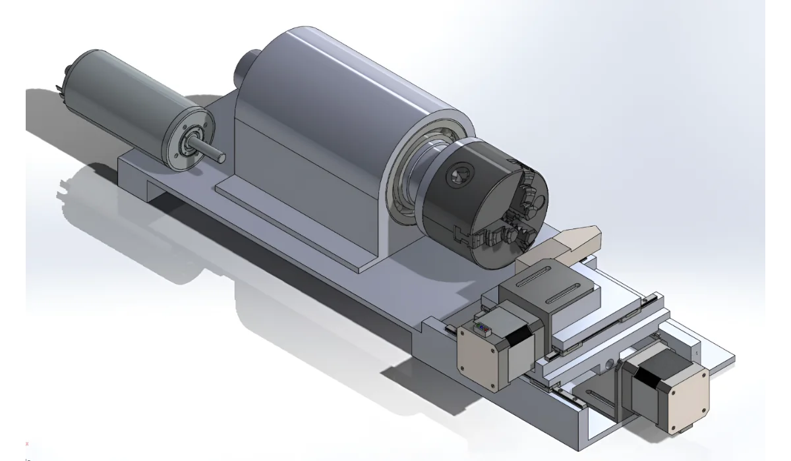
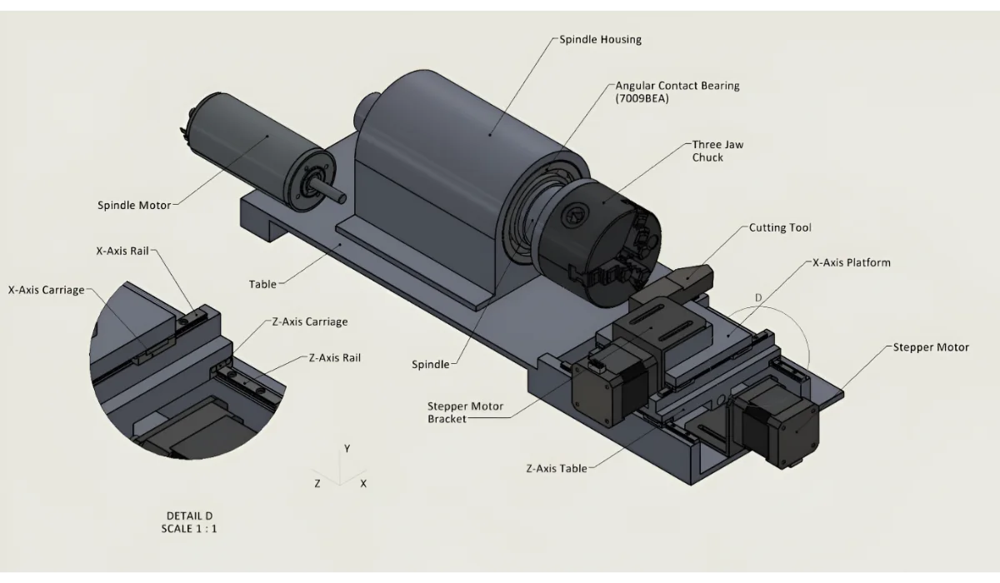
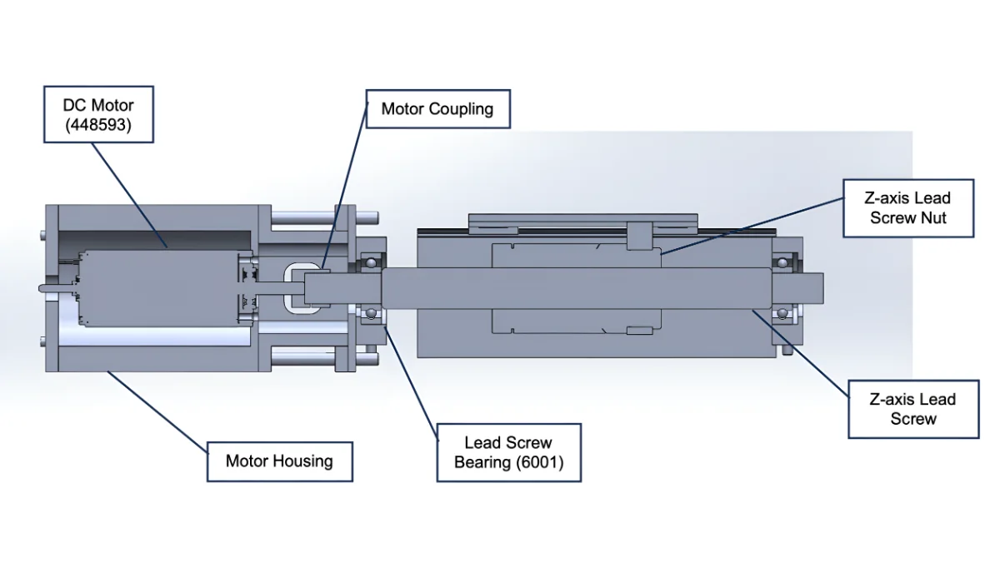
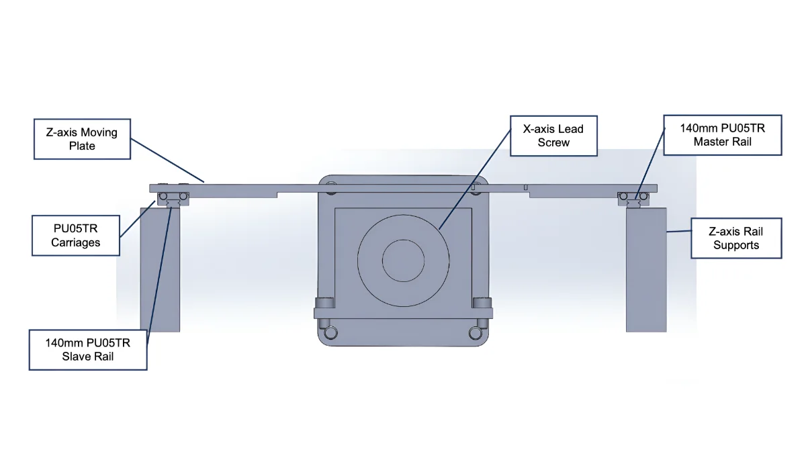
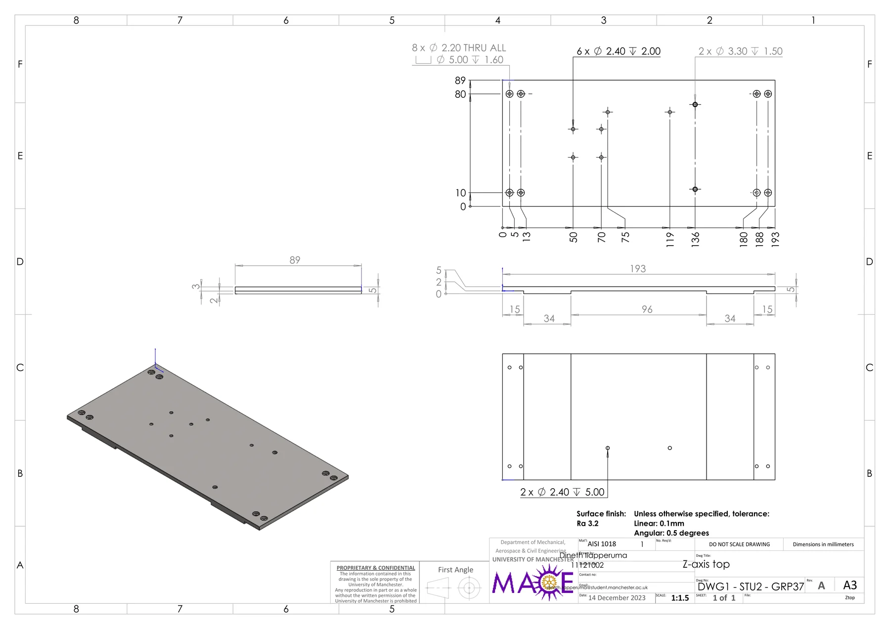
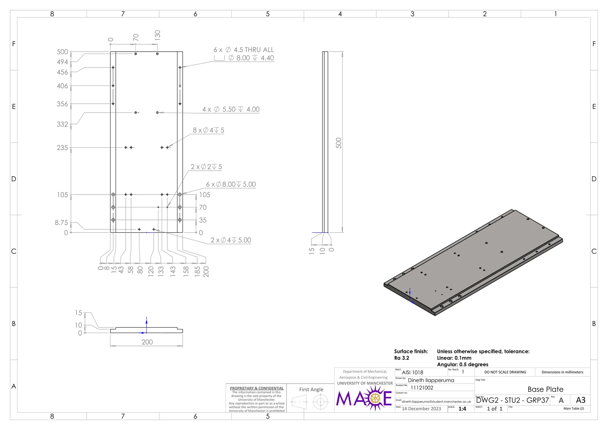
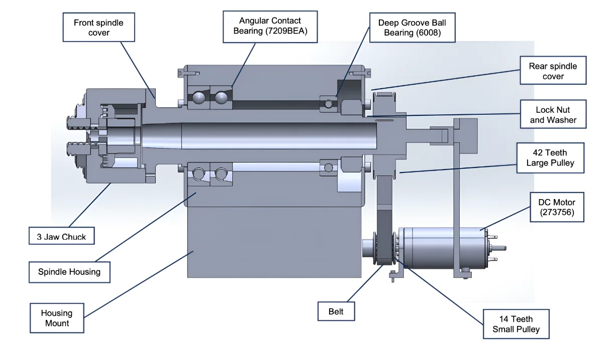
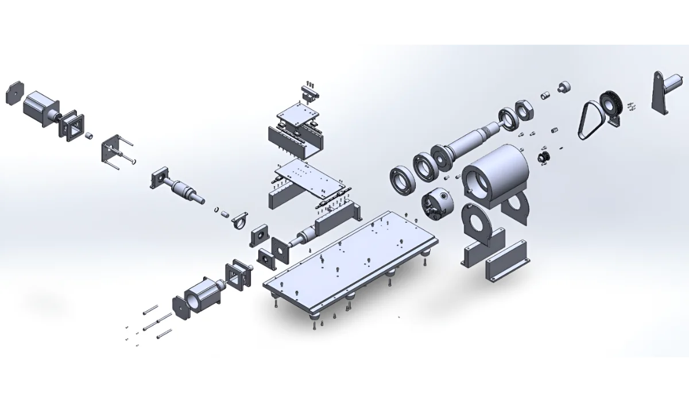

## Overview

A compact two-axis tabletop CNC lathe for machining aluminium and polymer workpieces up to 40 mm in diameter and length. It carries a three-jaw chuck, fits a 625 × 250 mm footprint, and is meant for classroom demonstrations and small-scale prototyping.

<figure class="figs figs-2">
  
  
  <figcaption>CAD model (left) and annotated drawing (right).</figcaption>
</figure>

## Design process

The design was organised around three subsystems: the spindle, the X stage and the Z stage. The aim throughout was rigidity.

- **Spindle and bearings.** Cutting forces set the bearing load ratings. Hertzian contact analysis and a tolerance stack-up drove the bearing selection, and spindle diameter and bearing spacing were tuned to hold deflection to 8 µm.
- **X and Z stages.** Linear rails and lead screws were sized for the vertical and axial loads.
- **Drive train.** A pulley-and-belt spindle drive and DC motors chosen for the torque and speed required.
- **Documentation.** Every machined and purchased part is specified through a BOM, first-angle GD&T drawings and process plans covering turning, grinding and milling.

<figure class="figs figs-2">
  
  
  
  
  <figcaption>Cross-sections of the Z-axis table (top) and the matching engineering drawings (bottom).</figcaption>
</figure>

## Results

- Design deflection under 8 µm at the cutting edge.
- Component selection verified by calculation for bearing load, spindle torque and lead-screw stress.
- A modular layout, so the stages and spindle can be maintained, repaired or upgraded separately.

<figure class="figs figs-2">
  
  
  <figcaption>Spindle housing in cross-section (left) and the full assembly, exploded (right).</figcaption>
</figure>
