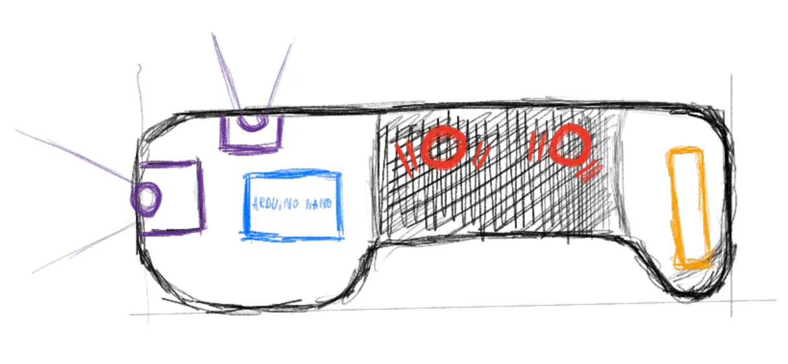
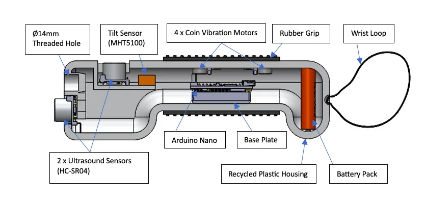
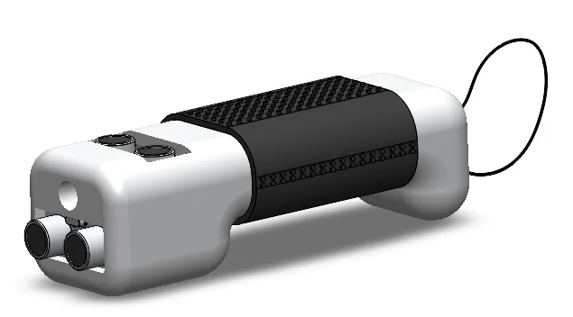
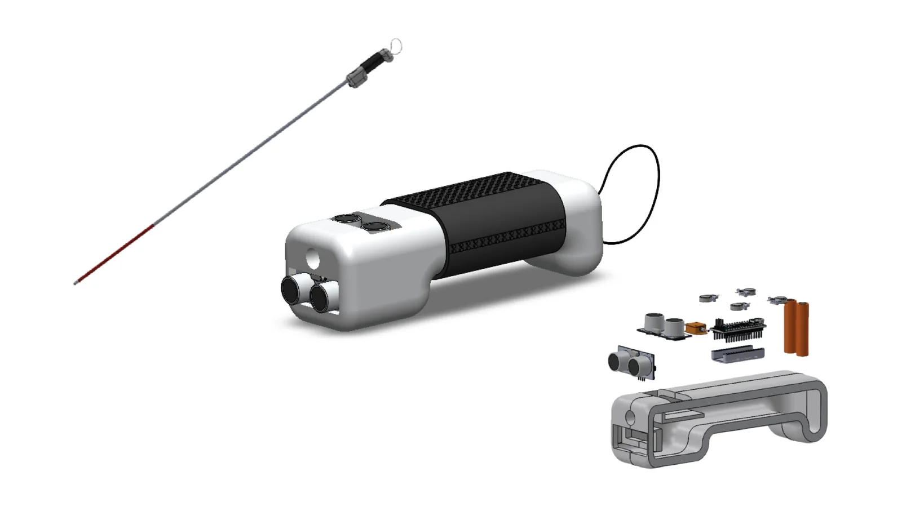

## Overview

A white cane finds what is on the ground. It does not find a low branch, an open window or a wing mirror. VIMA is a detachable handle that fits a standard cane, detects obstacles at ground level and overhead, and reports them as haptic feedback in the user's hand.

I founded VIMA and led it technically for three years, from first sketch to funded prototype.

<figure class="figs figs-3 figs-contain">
  
  
  
  <figcaption>From sketch, to cross-section, to assembled CAD.</figcaption>
</figure>

## Engineering

- **Design for manufacture.** The injection-moulded haptic mechanism was designed in SolidWorks with DFM/DFA rules and GD&T drawings, reaching single-shot tooling and fastener-free assembly.
- **DFMEA.** A failure mode and effects analysis across the haptic module removed the high-RPN failure modes before any prototype was built.
- **Embedded firmware.** C++ firmware synchronises the sensing arrays and actuators to deliver feedback in under 50 ms, validated through hardware-in-the-loop testing.
- **Sensing.** The first prototype used ultrasonic sensors on an Arduino. After diagnosing false positives in that pipeline I rebuilt the sensor architecture around LiDAR and trained a Soft Actor-Critic reinforcement learning algorithm, reaching 85% obstacle detection.

<figure class="figs">
  
  <figcaption>Exploded view, showing the handle's components and its fit to a standard cane.</figcaption>
</figure>

## Running it

- Secured £10,000+ in competitive funding from [Sister](https://sistermanchester.com) and the [Masood Entrepreneurship Centre](https://www.entrepreneurship.manchester.ac.uk), by turning trial results into reports for NHS partners and investment panels.
- Built Python pipelines across the trial datasets that cut data processing overhead by 60%.
- Ran the engineering, clinical and commercial workstreams alongside full-time study.
