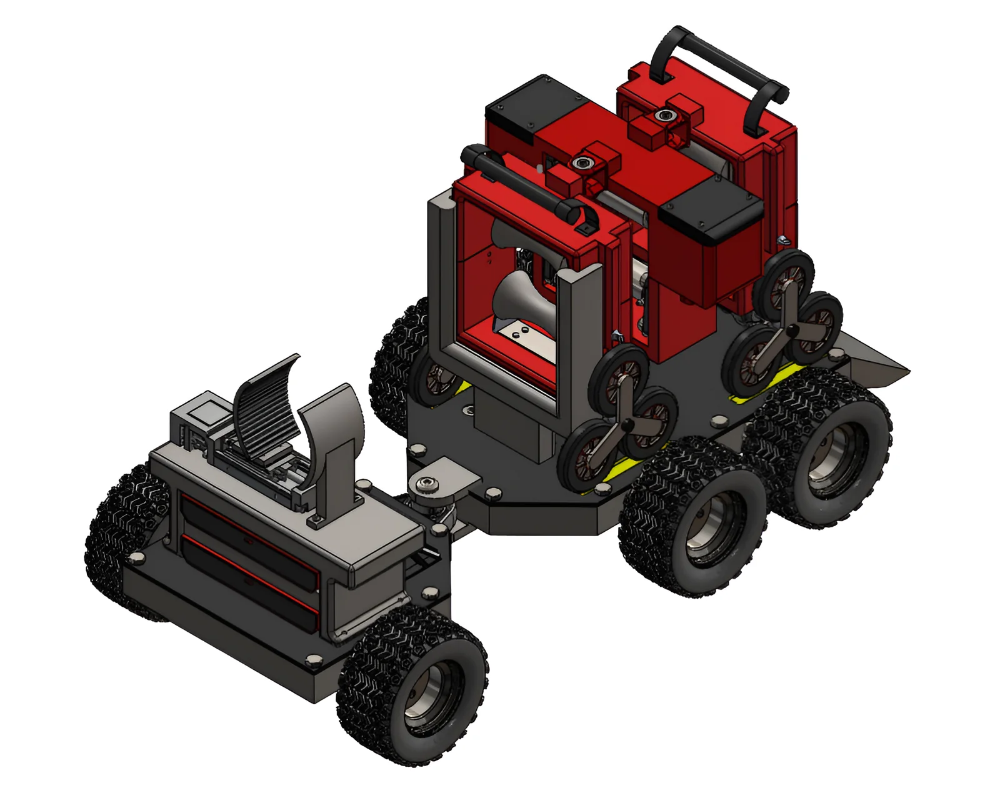
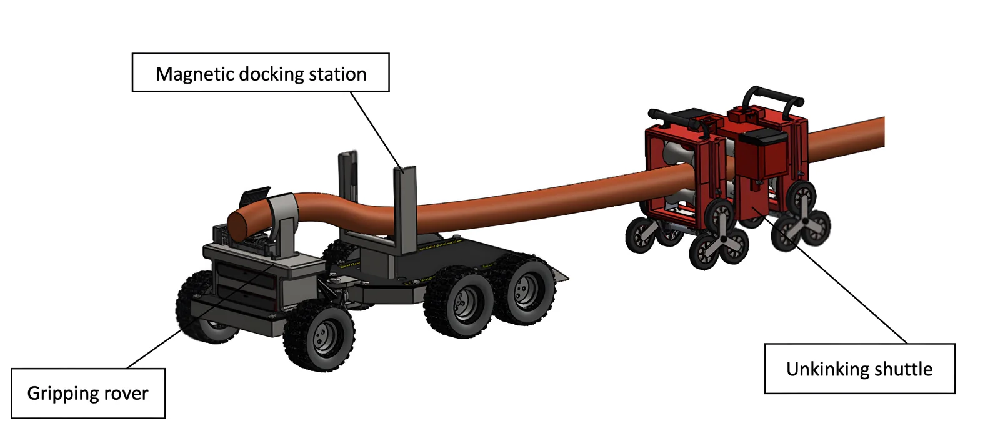
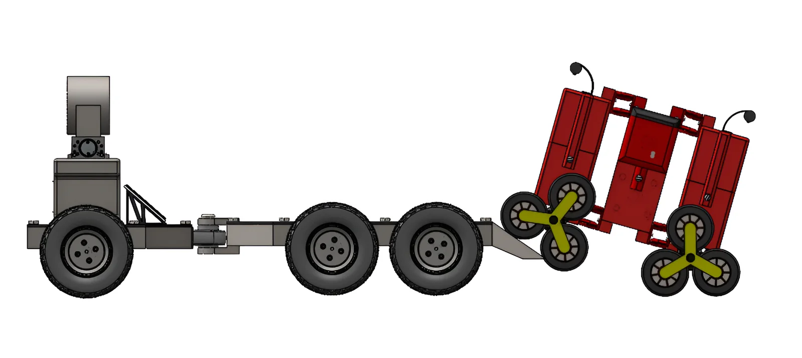
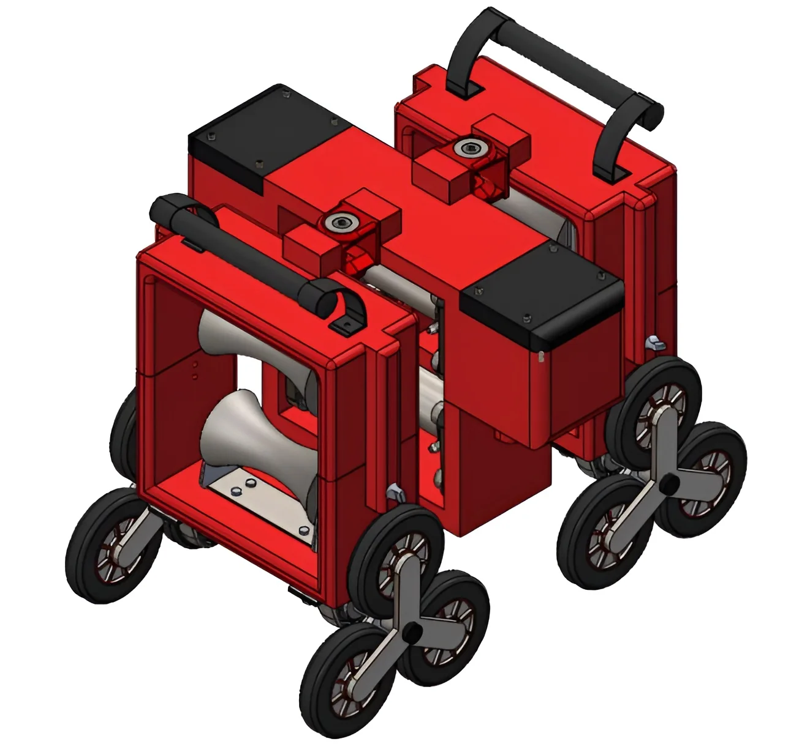

## Overview

A charged fire hose is heavy, and a kink in it cuts the water supply. This design helps firefighters advance hoses during high-pressure operations and removes kinks without anyone going back down the line. It was designed to be robust, simple to use and cheap to make, so it can serve rural and under-resourced crews.

<figure class="figs figs-contain">
  
  <figcaption>The complete system: gripping rover in front, unkinking shuttle docked behind.</figcaption>
</figure>

## How it works

Two modules work together.

**Gripping rover**

- A two-part chassis with a central pivot gives unpowered steering, so the rover stays aligned without electronics.
- Six all-terrain wheels, the front pair independently powered.
- A water-resistant, heat-shielded battery housing with quick-release access.

**Unkinking shuttle**

- Three modules: a powered central roller and two unpowered alignment modules.
- Hinged connectors let the shuttle snake along bends until it reaches a kink.
- Magnetic docking to the rover for storage and deployment.

**Details**

- Triangular wheel assemblies, each with three sub-wheels, "step" over rough ground.
- Concave rubber-lined arms grip 45 mm and 64 mm hoses, with an open-top actuator for quick mounting.

<figure class="figs figs-2 figs-contain">
  
  
  <figcaption>Rover and shuttle deployed along a hose.</figcaption>
</figure>

## Manufacture

The chassis is recycled aluminium 6061 with standardised off-the-shelf components and a full BOM, so the device can be repaired in the field. I simulated the assembly sequence and cycle time in Siemens Tecnomatix to settle the sub-assembly build order.

<figure class="figs figs-narrow">
  
  <figcaption>The shuttle's roller mechanism.</figcaption>
</figure>

## Sustainability

The design supports three UN Sustainable Development Goals.

- **Zero Hunger (SDG 2).** Where firefighting relies on self-organised effort, a device that minimally trained people can use helps communities protect crops.
- **Responsible Consumption and Production (SDG 12).** Modular design, standard parts and recycled aluminium extend service life and simplify repair.
- **Life on Land (SDG 15).** Faster hose deployment by a single firefighter improves wildfire response.

## Result

Graded 82%. Feedback highlighted the systematic concept evaluation, the detail of the CAD, and how clearly the operation was explained. The design grew out of an earlier concept, [Hydro-pede](/projects/hydropede/).
