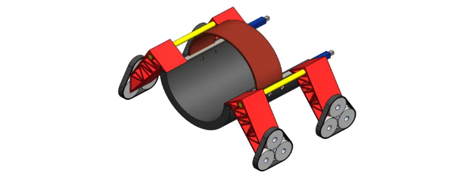
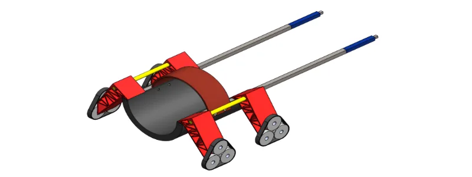
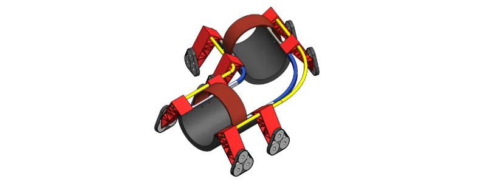
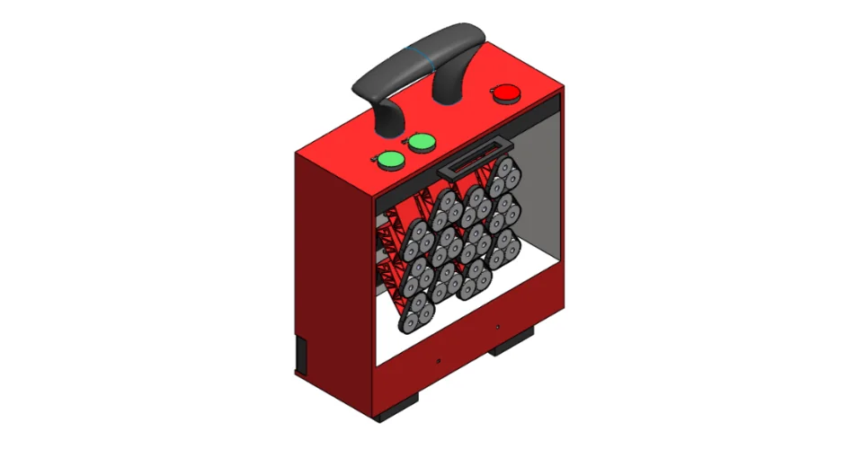
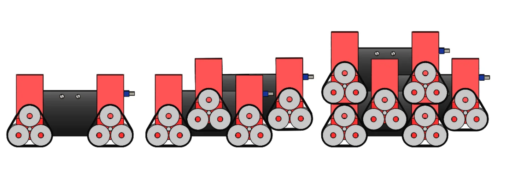

## Overview

Hydro-pede was the first concept in the development of the [Fire Hose Advancer](/projects/firehose/). It borrows the segmented locomotion of centipedes and millipedes to make a modular crawler that travels with a pressurised fire hose and supports it.

<figure class="figs figs-3 figs-contain">
  
  
  
  <figcaption>The coupler contracted, extended and bent.</figcaption>
</figure>

## Brief

- Develop the chosen concept into an embodiment design that follows engineering principles and design codes.
- Link the design to the Sustainable Development Goals and to equality, diversity, inclusion and access.
- Present the concept through annotated sketches alone.

<figure class="figs figs-2 figs-contain">
  
  
  <figcaption>A portable battery pack for remote use, and the body in one, two and three-segment configurations.</figcaption>
</figure>

## Result

Graded 95%. The feedback praised the clarity of the mechanisms and sketches, and pointed to three improvements that shaped the next design: protect the exposed power cable, automate hose threading, and fit larger wheels for rough terrain.
