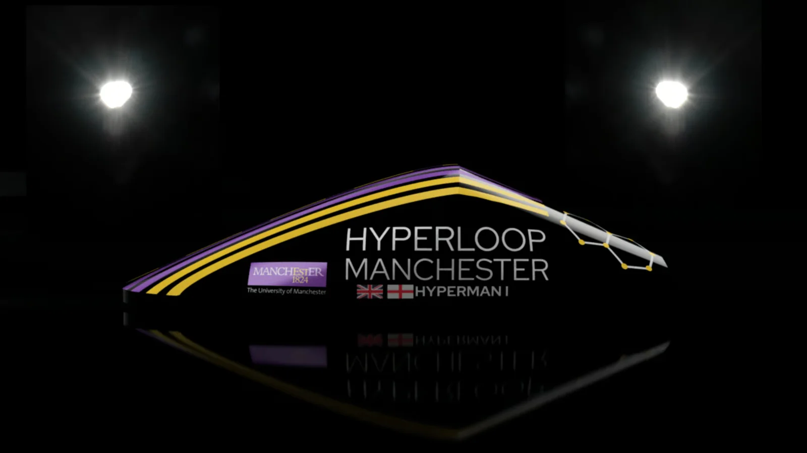

## Overview

I led the structural sub-team for Hyperloop Manchester's vacuum capsule. My responsibility was the airlock: the most mechanically demanding sub-assembly, loaded by about 101 kPa of differential pressure every time the tube is pumped down.

<figure class="figs">
  
  <figcaption>The Hyperloop Manchester pod.</figcaption>
</figure>

## The structural problem

The airlock has to:

- withstand a full atmosphere of pressure differential,
- seal hermetically under repeated loading cycles,
- stay light, and
- integrate with the capsule shell.

## What I did

**Analysis.** Finite element analysis of the pressure vessel under 101 kPa showed stress concentrating at the door hinge attachments. Redesigning the hinge brackets cut peak von Mises stress by 38%, with a 2.5× safety factor and a 15% mass saving.

**Fabrication.** I led the build of the aluminium 6061-T6 airlock frame, coordinating CNC machining with the university workshop, and designed a jig that aligned the door sealing face to ±0.1 mm.

**Change control.** Every design revision was traced from test failure to corrected geometry through updated drawings, GD&T and engineering change notes.

## Outcome

The airlock held 10⁻³ mbar across 50 vacuum cycles with zero seal failures.
