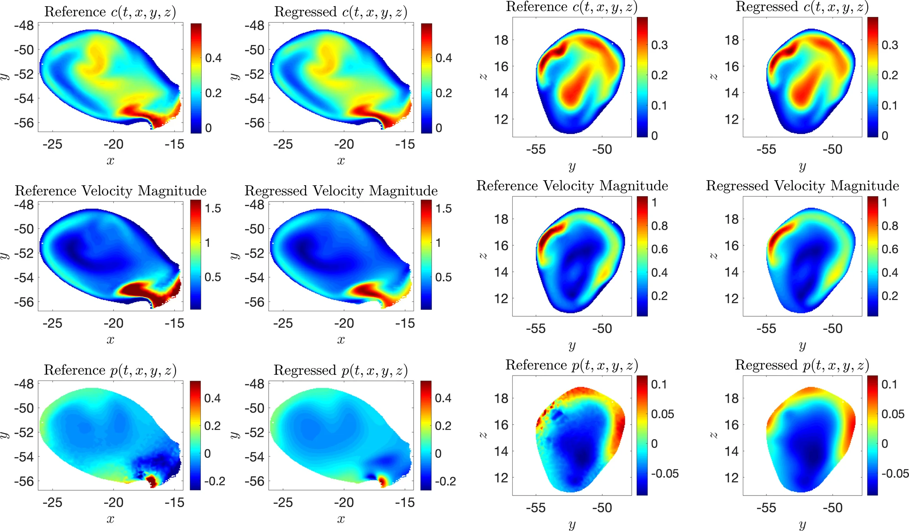
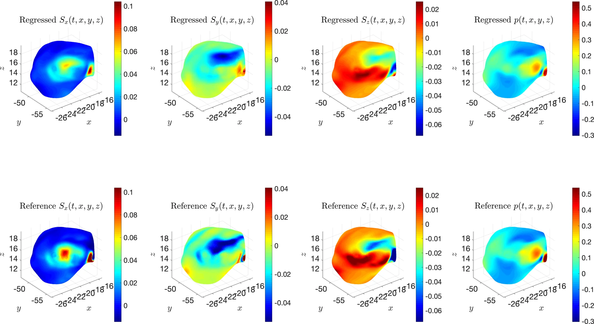

## The problem

Wall shear stress and oscillatory shear are the best predictors we have of whether a brain aneurysm will rupture. Getting them means running a patient-specific CFD simulation, and each one takes hours. That is too slow to sit inside a clinical decision.

My MSc dissertation at Imperial asked whether a physics-informed neural network could give the same flow field fast enough to be useful at the point of care.

## Approach

A PINN does not just fit data. The Navier–Stokes equations are written into the loss function, so the network is penalised whenever its prediction breaks conservation of mass or momentum.

- **Quasi-Cartesian embedding.** The curved vessel geometry is mapped to a structured domain before it reaches the network, which improves gradient flow and convergence over plain collocation-point PINNs.
- **Multi-task loss.** PDE residuals, boundary conditions (no-slip walls, a pulsatile Womersley inlet) and sparse CFD snapshots are minimised together.
- **NTK-informed loss weighting.** The balance between the loss terms adapts during training instead of being hand-tuned.

```
(x, y, z, t)  →  encoder  →  6 residual blocks  →  (u, v, w, p)

loss = λ₁·L_pde + λ₂·L_bc + λ₃·L_data
```

Training ran on Imperial's HPC cluster across four A100 GPUs with PyTorch DistributedDataParallel, scheduled through SLURM. Every run was tracked in Git and evaluated automatically against CFD ground truth.

## Results

<figure class="figs figs-2">
  
  
  <figcaption>Left: velocity and pressure, CFD reference against the network's prediction. Right: wall shear stress reconstructed by the network.</figcaption>
</figure>

| Measure | Result |
| --- | --- |
| Velocity MAE against CFD | < 4% |
| Pressure RMSE | < 6% |
| Inference, full 3D field | < 80 ms |
| Training, 4× A100 | about 14 hours |

I quantified the surrogate's error across six patient geometries using hyperparameter search, cross-validation and sensitivity analysis. That work also showed where the model fails: error concentrates at the domain boundaries, which is where the next round of work should go.

## Why it matters

With inference this fast, wall shear stress and oscillatory shear index maps can be produced while the patient is still in the room. It is a route from a research-grade simulation to a pre-operative planning tool.

This project builds directly on my [undergraduate aneurysm CFD work](/projects/Aneurysms/), which produced the kind of simulations this network learns to replace.
