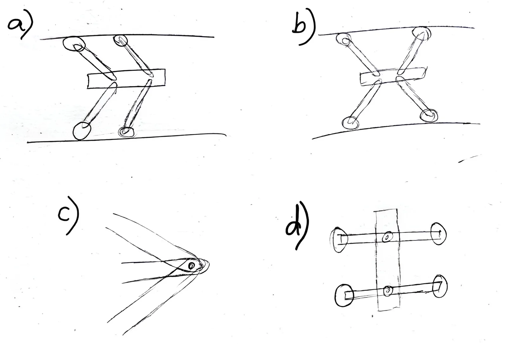
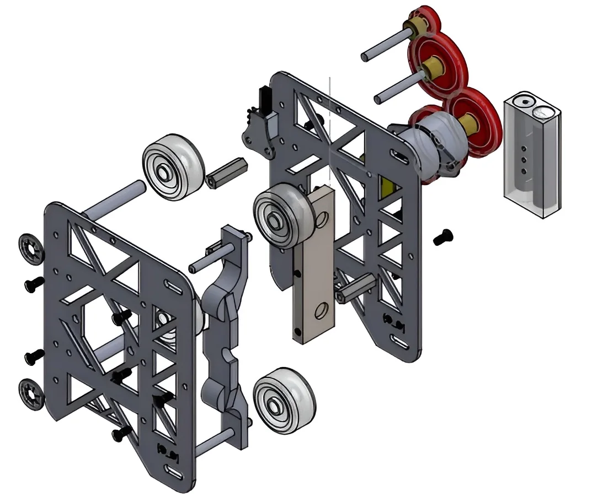
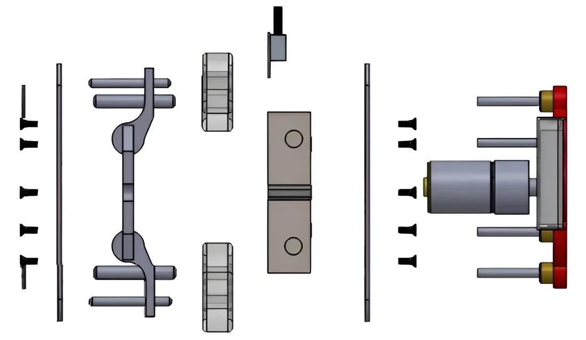
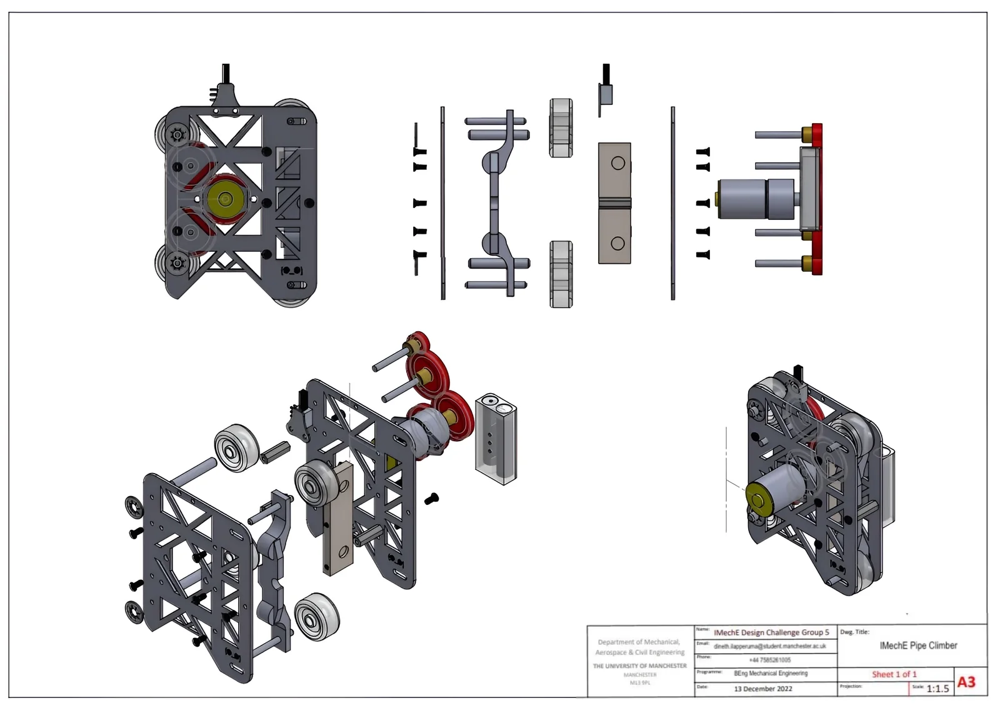

## Overview

For the [IMechE Design Challenge](https://www.imechedesignchallenge.org/wp-content/uploads/2023/01/IMechE-1st-Year-Design-Challenge-Project-Specification-2023-V1.1.pdf) I designed and built a climber that ascends a 2 m vertical pipe from the inside, lifts a 0.265 kg chain, and returns to the start as fast as possible. The challenge mirrors the pigging operations used to inspect and clean pipelines.

The constraints were tight:

- no more than £30 for every made and bought part,
- fit inside a 105.6 mm diameter and 300 mm length,
- a motor of at most 6 V and 2 W, and
- no control electronics of any kind.

## Design

<figure class="figs">
  
  <figcaption>Initial concepts.</figcaption>
</figure>

- **Tripod.** Light, but aligning the wheels and axles within the envelope was impractical.
- **Quadrant.** Good for a free-fall return, but the spring-loaded wheels were unstable.
- **Rectangular chassis (chosen).** A stiff frame for the motor, battery and gears, with triangular cut-outs to shed weight.

## FMEA

A failure mode and effects analysis was run twice, before and after testing. It flagged three risks: too little spring tension to grip the wall, tyres with too little friction, and too much weight to reach the top. Each was addressed through spring rate, tyre selection and chassis lightening.

<figure class="figs figs-2 figs-contain">
  
  
  <figcaption>Exploded views of the climber.</figcaption>
</figure>

## Result

The climber ascended the pipe with its load and returned under gravity in 21 seconds, passed scrutineering, and performed consistently within the competition constraints. Early prototypes slipped; higher-tread tyres and a lighter chassis fixed it.

<figure class="figs">
  
  <figcaption>Assembly drawing.</figcaption>
</figure>
